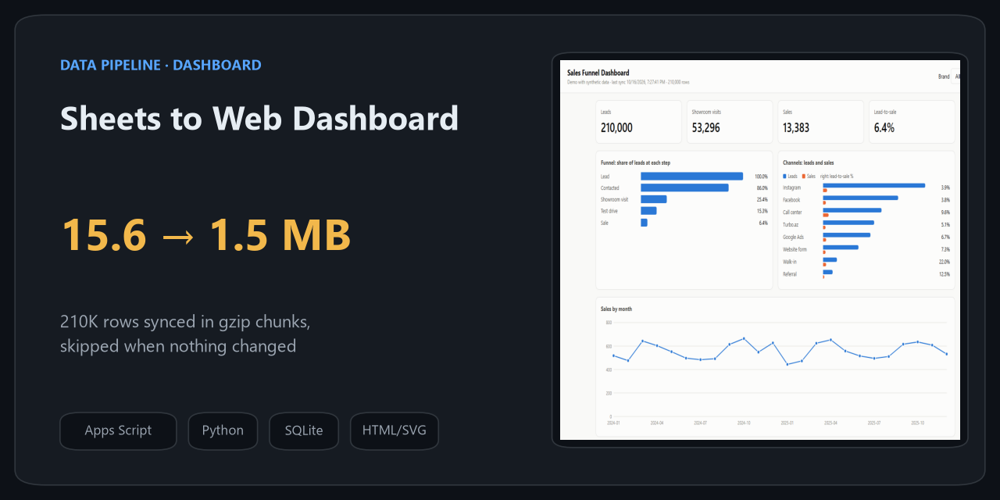
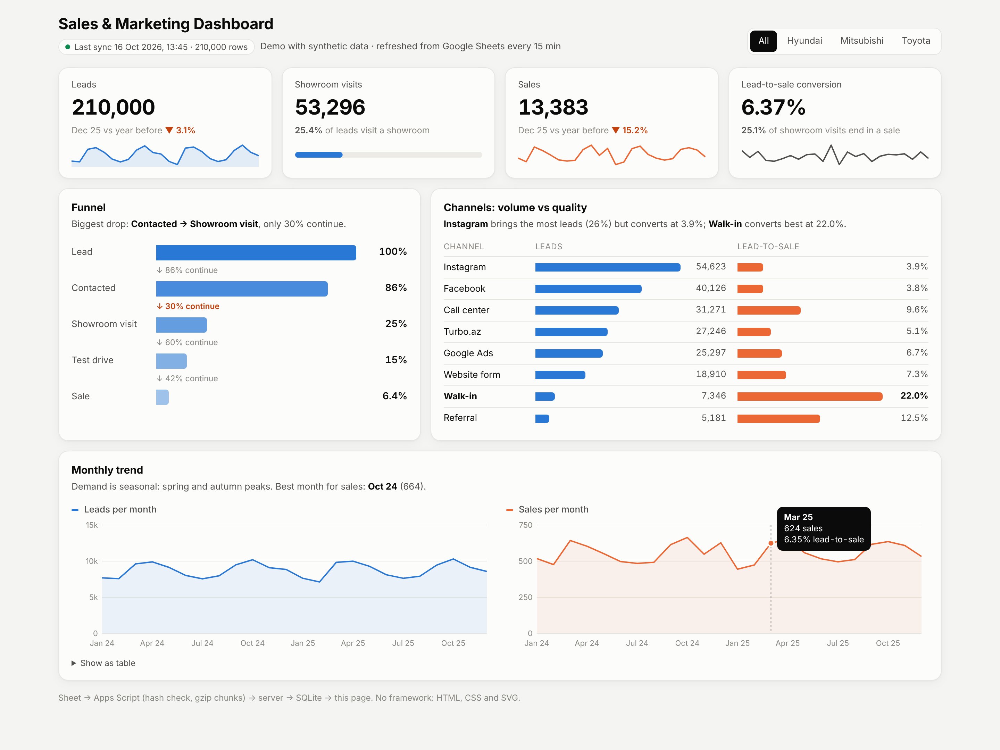
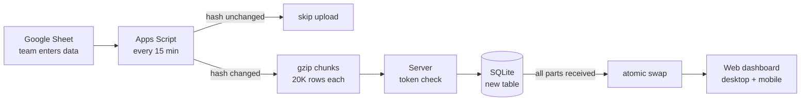
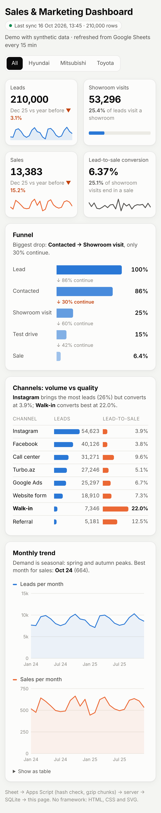

# Sheets to Web Dashboard

A small, working template for a common situation: **the team keeps its data in Google Sheets and does not want to change that, but the reports are slow, manual or break above a few hundred thousand rows.**

The sheet stays the place where people work. Apps Script pushes the data to a server every 15 minutes, the server stores it in a database, and a web dashboard reads from there.

I built a production version of this for a car dealer group's marketing and sales team. This repo is a **from-scratch simplified version with synthetic data**: no company code, data, addresses or keys.



## How it works



| Problem | Decision |
|---|---|
| Re-sending unchanged data every 15 minutes wastes quota and time | SHA-256 of the sheet data; if it matches the last sync, nothing is sent |
| Request body limits on the server side | Rows are split into 20K-row chunks and gzip-compressed (210K rows: 15.6 MB → 1.5 MB) |
| A half-finished upload would show half the data | Parts go into a new table; the live table is replaced in one transaction only after the last part |
| No service account keys allowed | The script runs as the sheet owner and pushes the data itself; the server only checks a shared token |
| People open it on their phones | Plain HTML/CSS/SVG, no framework, responsive layout |

<p align="center"></p>

## Run it locally (no Google account needed)

`tools/simulate_sync.py` does exactly what the Apps Script does (hash, gzip, chunks, same headers), using 210K synthetic rows (real model names such as Toyota RAV4 or Hyundai Tucson, generated numbers).

```bash
pip install -r requirements.txt

export SYNC_TOKEN=any-long-random-string     # Windows PowerShell: $env:SYNC_TOKEN="..."
python server/app.py                          # http://localhost:8000

# in a second terminal, same SYNC_TOKEN
python tools/simulate_sync.py                 # uploads 210,000 rows in 11 parts
python tools/simulate_sync.py                 # "No changes since last sync, skipped."
python tools/simulate_sync.py --seed 2        # new data -> uploads again
```

## Use it with a real sheet

1. Sheet named `Leads` with columns: `lead_id, created_at, channel, brand, model, contacted, visited, test_drive, sold`.
2. Extensions → Apps Script → paste [`apps_script/Code.gs`](apps_script/Code.gs).
3. Project Settings → Script Properties: `SERVER_URL` (your HTTPS domain) and `SYNC_TOKEN`.
4. Run `installTrigger()` once.
5. Deploy `server/app.py` behind HTTPS (e.g. a reverse proxy with a certificate). Do not expose it over plain HTTP: the token travels in a header.

## Structure

```
apps_script/Code.gs      sheet -> server sync (hash check, gzip, chunks, trigger)
server/app.py            upload endpoint, atomic table swap, /api/summary, static files (stdlib only)
web/index.html           dashboard: KPIs, funnel, channels, monthly sales, brand filter
tools/simulate_sync.py   local stand-in for the Apps Script, with synthetic data
```

## What the production version adds

Personal login per user, more pages (market share, stock vs target, call center), server-side pre-aggregation for faster loading, and a migration check: before switching from the old reporting panel, every metric was compared number by number in 16 steps and 19 acceptance tests were run.

Most of the production code was written with Claude Code (AI-assisted). The architecture, trade-offs and validation were mine.
